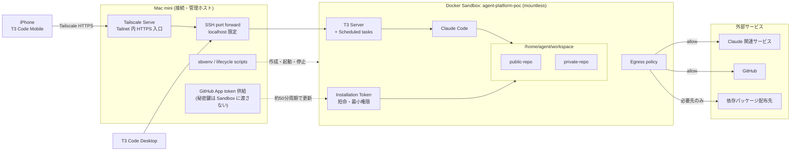
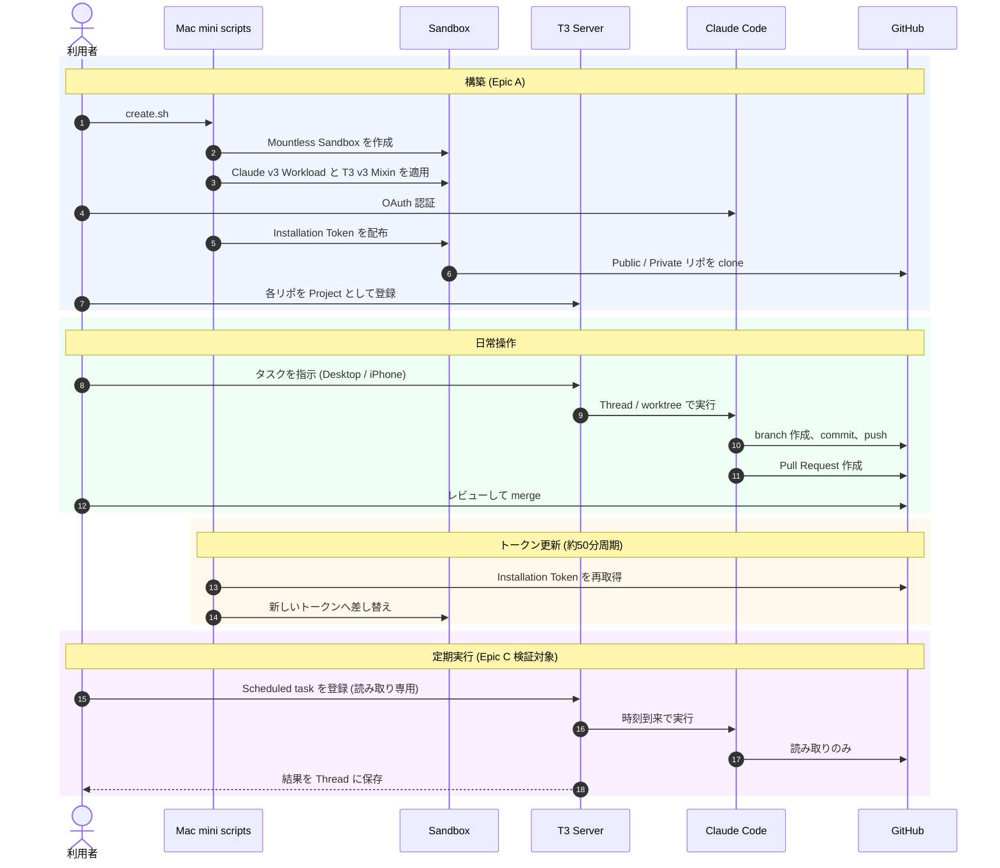
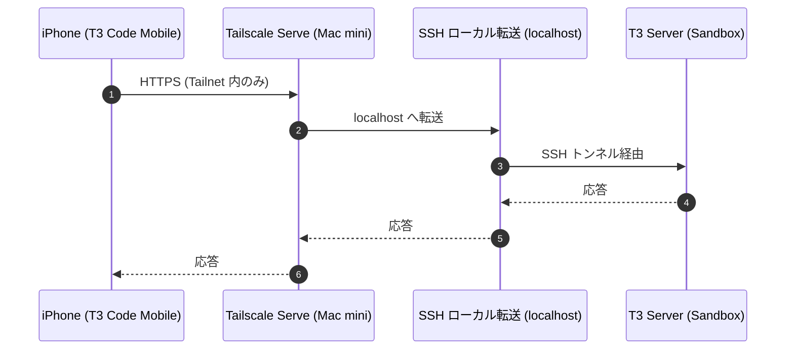
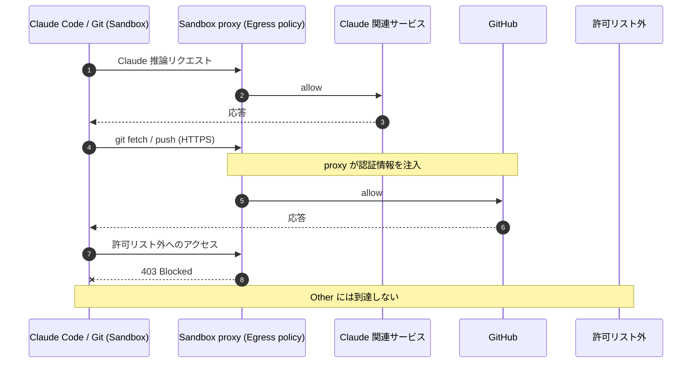

# Agent Sandbox Platform

Mac mini 上の Docker Sandboxes で Claude Code と T3 Server を動かし、複数プロジェクトを権限制御された形で並列実行する PoC。

- 計画の詳細: [.claude/plan.md](.claude/plan.md)
- タスク: GitHub Issues #1〜#12(Milestone M0〜M4)

> **ステータス**: PoC 計画段階。以下の図は **目標構成** を表しており、未検証・未実装の部分を含む。
> 実証済みの範囲は [plan.md の「実証済みのベースライン」](.claude/plan.md) を参照。

## 1. ディレクトリ構成

リポジトリの **予定構成**(現時点で実在するのは `.github/` と `.claude/` のみ)。

> `treeView-beta` は Mermaid v11.14.0 以降が必要な beta 機能。表示されない環境では、Mermaid のバージョンを確認すること。

| パス | 役割 |
|---|---|
| `docs/decisions/` | ADR(選定理由・トレードオフ) |
| `environments/poc.sbxenv.yaml` | Mountless / Kit 選択 / 非秘密設定 |
| `config/network-policy.example.yaml` | PoC 独自形式のネットワークポリシー(公式 `sbxenv` の項目ではない) |
| `scripts/` | Sandbox のライフサイクル、ポリシー適用、モバイルペアリング |
| `tests/` | 手順書形式の検証記録(smoke / network / scheduled tasks / recovery) |

秘密鍵、トークン、iPhone ペアリング URL、トークン更新ログはコミットしない。

## 2. アーキテクチャ図

**信頼境界**: Project / Thread / worktree は作業管理の単位であって、アクセス権の隔離ではない。Public / Private リポが同居する Sandbox では、互いのファイルが見える。権限や実行リスクが異なる場合は Sandbox を分ける。

## 3. 処理シーケンス図

環境構築から、日常の操作、定期実行までの流れ(目標)。

## 4. 通信フロー図

### 4.1 クライアントから Sandbox へ(インバウンド)

Tailscale Serve は Tailnet 限定、Mac 側の転送は localhost 限定を維持する。

### 4.2 Sandbox から外部へ(Egress)

宛先の FQDN・プロトコルの棚卸しは Issue #5、実効ポリシーの Allow / Deny テストは Issue #7 で実施する。Kit 由来の許可を含む **実効ポリシー** は実測で確認すること。

## 参考資料

- [Docker — Sandbox environment files](https://docs.docker.com/ai/sandboxes/configuration/environment-files/)
- [Docker — Use kits](https://docs.docker.com/ai/sandboxes/customize/use-kits/)
- [Docker — Manage local network rules](https://docs.docker.com/ai/governance/local/network-rules/)
- [Docker — Connect T3 Code to a sandbox](https://docs.docker.com/ai/sandboxes/integrations/t3-code/)
- [T3 Code — Remote access](https://github.com/pingdotgg/t3code/blob/main/docs/user/remote-access.md)
- [Mermaid — Tree View](https://mermaid.ai/open-source/syntax/treeView.html)
